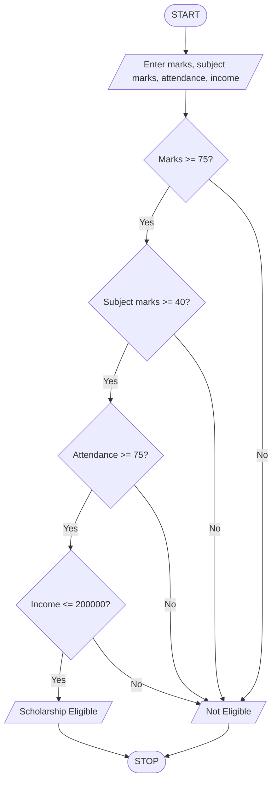

marks = int(input("Enter aggregate marks: "))
subject = int(input("Enter minimum subject marks: "))
attendance = int(input("Enter attendance percentage: "))
income = int(input("Enter family income: "))

if marks >= 75 and subject >= 40 and attendance >= 75 and income <= 200000:
    print("Scholarship Eligible")
else:
    print("Scholarship Not Eligible")

Algorithm
1. Start.
2. Enter aggregate marks.
3. Enter minimum subject marks.
4. Enter attendance percentage.
5. Enter family income.
6. Check all eligibility conditions.
7. If all conditions are satisfied, display “Scholarship Eligible”.
8. Otherwise, display “Scholarship Not Eligible”.
9. Stop.
Sample Input and Output
Enter aggregate marks: 85
Enter minimum subject marks: 45
Enter attendance percentage: 90
Enter family income: 150000
output
Scholarship Eligible
## Flowchart td

