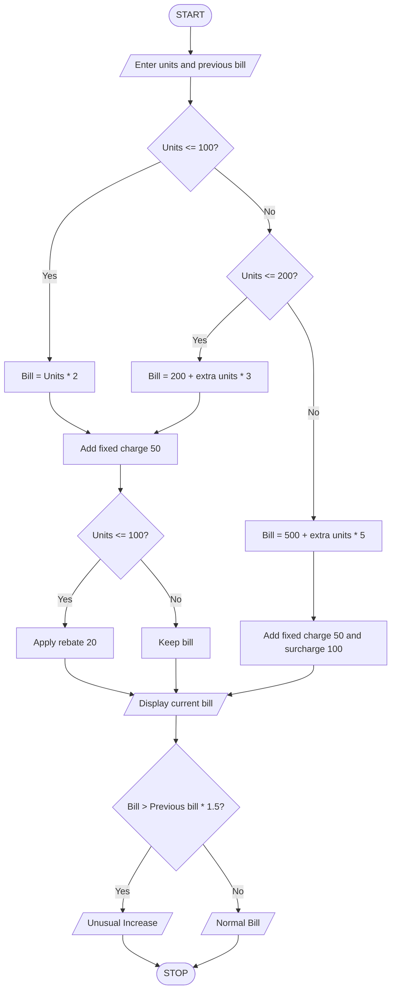

units = int(input("Enter electricity units: "))
previous = int(input("Enter previous month bill: "))

if units <= 100:
    bill = units * 2
elif units <= 200:
    bill = 200 + (units - 100) * 3
else:
    bill = 500 + (units - 200) * 5

bill = bill + 50

if units > 200:
    bill = bill + 100

if units <= 100:
    bill = bill - 20

print("Current Bill:", bill)

if bill > previous * 1.5:
    print("Unusual Increase")
else:
    print("Normal Bill")
Algorithm
1. Start.
2. Enter electricity units and previous month's bill.
3. If units are up to 100, charge ₹2 per unit.
4. If units are 101–200, calculate the bill using the second slab.
5. If units exceed 200, calculate the bill using the third slab.
6. Add ₹50 fixed charges.
7. Add ₹100 surcharge if units exceed 200.
8. Give a ₹20 rebate if units are up to 100.
9. Display the current bill.
10. Compare it with the previous bill.
11. Display unusual increase or normal bill.
12. Stop.
Sample Input and Output
Input
Enter electricity units: 250
Enter previous month bill: 600

Calculation
₹500 + (50 × ₹5) + ₹50 + ₹100 = ₹900

Output
current Bill:900
Normal Bill:300

